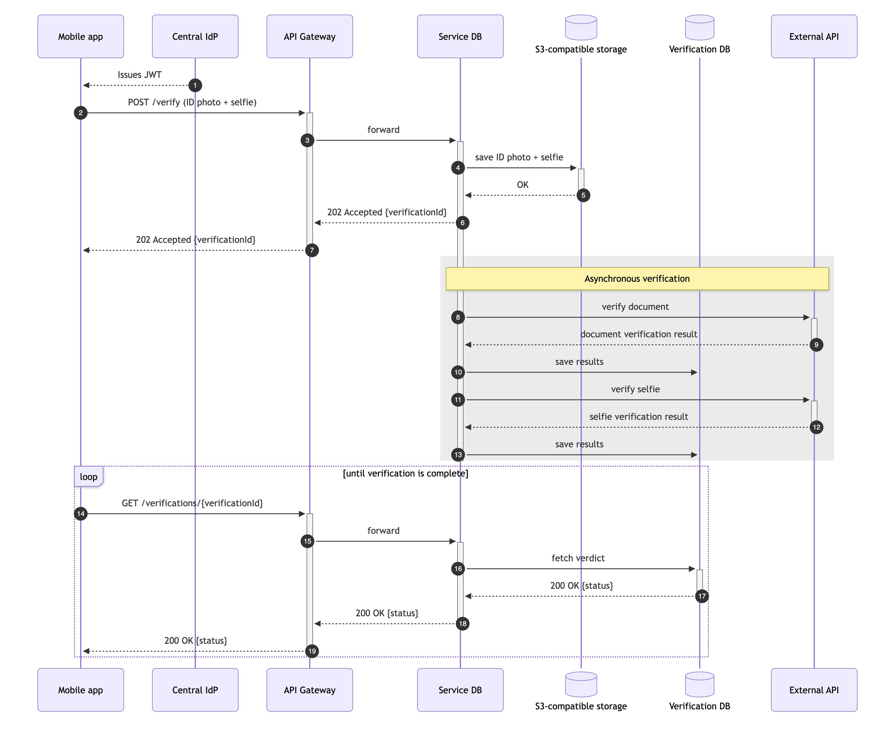

# Security design interview cases.

### Diagram №1 (KYC verification).
A fintech company must verify the identity of its users before they can use financial features. This is known as KYC (Know Your Customer), and regulators require it. A user signs in to the mobile app, takes a photo of their ID document and a selfie, and sends both for verification. The company doesn't build verification itself: it uses an external KYC provider. The provider checks that the document is genuine and that the selfie shows the same person as the document.

Interesting questions you can ask about this diagram:
- Is it OK to use a web browser instead of a mobile application?
- Where would Temporal fit in this diagram? What new security risks does Temporal introduce?
- Is it possible to DoS the service?
- How should the mobile application store the JWT securely?
- What compliance problems do you see?

